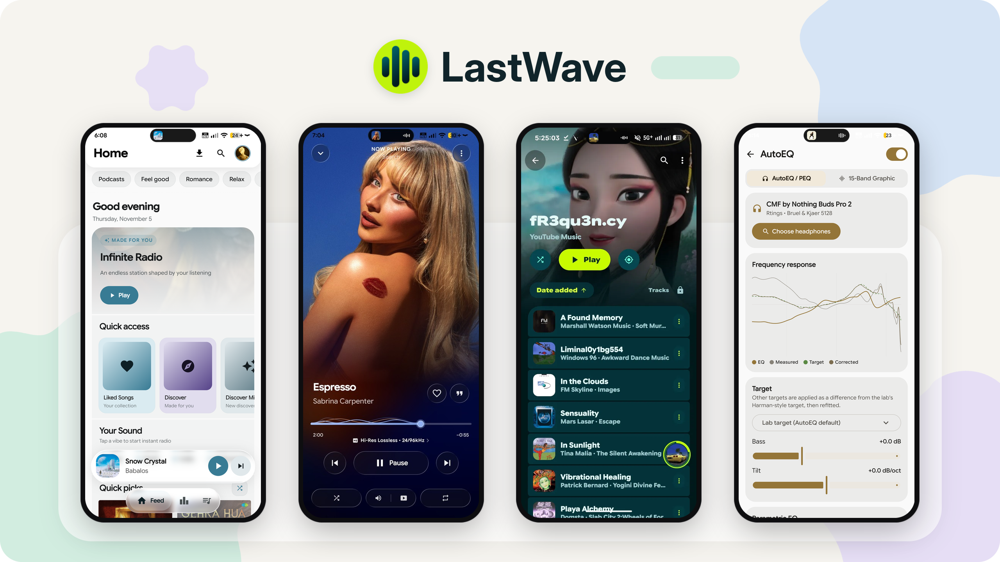

<div align="center">



<h1>LastWave — Silent Programmer Edition</h1>

**Simple Android YouTube Music client with Material UI, Liquid Glass, Bit-Perfect playback, Automix, Lossless addons & advanced audiophile features.**

### Developer: Tanmay aka Silent Programmer

<p align="center">
  
</p>
</div>

---


## Overview

LastWave is a fast, native YouTube Music client for Android that looks great and sounds even better. Built with Material 3 Expressive and Liquid Glass UI, it gives you a clean, fluid design that adapts to your music.

For audio lovers, LastWave packs Bit-Perfect USB DAC output, Lossless FLAC addon support, AutoEQ headphone presets with parametric EQ, smooth Automix transitions, Spotify Canvas & integration, and real-time synced lyrics, all in a lightweight app.

---


## Features

<table>
  <tr>
    <td width="50%" valign="top">

#### Playback
- Stream any track or video from YouTube Music
- Background playback with lockscreen & Android Auto controls
- High-res audio downloads with embedded tags & `.lrc` lyrics
- Pick which source a download comes from: Auto, YouTube Music, or one named add-on server
  — with automatic fallback and the completion notice naming what actually served the file
- Download & cache for offline listening
- Skip silence & sleep timer

</td>
    <td width="50%" valign="top">

#### Audio
- Bit-Perfect USB DAC output (direct hardware bypass)
- Lossless FLAC addon support (up to 24-bit Hi-Res)
- 15-band Parametric Equalizer & AutoEQ headphone presets
- Smart Automix transitions & smooth crossfade
- Audio normalization (ReplayGain / LUFS)
- Real-time tempo & pitch control

</td>
  </tr>
  <tr>
    <td width="50%" valign="top">

#### Lyrics & Discovery
- Live millisecond-synchronized lyrics (LRCLIB)
- Lyrics romanization for non-Latin scripts (Japanese, Korean, etc.)
- Multi-language lyrics translation
- Spotify Canvas & animated video backgrounds (Apple Music & Tidal)
- Personalized quick picks, mood radios & genre discovery
- Search songs, albums, artists, videos, and playlists

</td>
    <td width="50%" valign="top">

#### Library & Account
- Full library management & offline cached library
- Spotify Integration (Account login, Liked Songs sync & deep links)
- Import public playlists from Spotify & Apple Music
- YouTube Music account login & bidirectional sync
- Local & cloud playlists with custom reordering
- Custom audio tag editing & cover art selection

</td>
  </tr>
  <tr>
    <td width="50%" valign="top">

#### Social
- Listen together with friends in real-time
- Built-in Last.fm scrobbler with background tracking
- Safe Discord Rich Presence with live album art
- Export and share lyrics as aesthetic quote cards

</td>
    <td width="50%" valign="top">

#### Interface
- Material 3 Expressive & Liquid Glass UI
- Real-time backdrop refraction shaders
- Dynamic Monet theming + 19 preset color palettes
- Light, Dark, Pure Black (AMOLED), and Dynamic modes
- Interactive home screen widgets & fluid tactile haptics

</td>
  </tr>
</table>

---


## Getting Started

### Installation

| Channel | Source | Compatibility |
|:---|:---|:---|
| **Stable Release** | [GitHub Releases](/releases) | Recommended for all users • Android 10+ (API 29+) |
| **Nightly Builds** | [GitHub Actions](/actions) | Latest automated builds with bleeding-edge features |
| **Desktop App** | [LastWave-Desktop]() | Official desktop client for Windows, macOS & Linux |

### Quick Setup

1. Install the APK on your Android device.
2. *(Optional)* Navigate to **Settings → Audio** to configure:
   - **Bit-Perfect Output:** Enable exclusive USB DAC mode for bit-perfect audio.
   - **AutoEQ Presets:** Search for your headphones/IEMs to apply calibrated parametric EQ curves.
   - **Lossless Addons:** Enable the modular addon service for 24-bit Hi-Res FLAC playback.
3. Start streaming music, listening to customized radios, and enjoying synced lyrics!

---

## Building from Source

### Prerequisites
- **JDK:** OpenJDK 17 or higher
- **Android SDK:** API Level 34+ with CMake & Android NDK installed (for native audio C++ engine & USB driver)

### Build Instructions

```bash
# Clone the repository
git clone .git
cd LastWave-native

# Build the release APK
./gradlew assembleRelease

# The generated APK will be at:
# app/build/outputs/apk/release/app-release-unsigned.apk
```

> [!TIP]
> For local development and debugging, run `./gradlew assembleDebug` or install directly to a connected device via `./gradlew installDebug`.

---

## Support

This edition is maintained by **Tanmay aka Silent Programmer**.

- **Developer:** Tanmay aka Silent Programmer
- **Edition:** Silent Programmer Edition
- **Updates:** in-app, from this fork's own GitHub releases

### In-App Updates

**Settings → About & Community → Updates** checks this fork's releases and can install a new
version without leaving the app. It is what the same screen looked like before the Silent Programmer
build cut the updater for pointing at somebody else's repository; it is back, pointed here.

* **Where it looks:** `api.github.com/repos/Tanmay-Tiwaricyber/LastWave/releases/latest`.
  At most once every 12 hours, on startup only while **Check on startup** is on (it is by default),
  plus a manual check from the row. Dismissing a version keeps the banner away until a *newer*
  tag appears — never until the next app launch, which is what makes a dismiss button a lie.
* **What counts as a release:** a tag that is newer than the installed version (`v5.9.0` over
  `5.8.0`, compared by number, so `5.10.0` beats `5.9.0`) **and** an attached APK whose file name is
  recognisable as ours (`LastWave…`, `Silent Programmer…`). A release with no such APK is reported as
  "no installable APK attached"; the updater will not install "whatever `.apk` happens to be there".
* **What is verified before the installer is offered the file:** the byte count against the release's
  recorded size, the SHA-256 against the `digest` GitHub computes for that asset (or the matching line of
  a `CHECKSUMS.txt` asset, if one is attached), the APK's `versionCode` against the installed one, and
  the signing certificate against this app's. The dialog says which of those actually ran — a release
  that recorded no digest is reported as "no digest recorded", not as "verified".
* **What it needs from Android:** the `REQUEST_INSTALL_PACKAGES` permission and, once, the
  **Install unknown apps** switch for LastWave; tapping *Install* links straight to it. The install
  itself is performed by the system installer, which refuses an APK not signed with the same key as the
  installed app — that is the last line of defence, not the app's own checks.
* **Releasing a new version** therefore needs two things: the repository public, and a release with the
  APK attached. Nothing else to upload — the hash is computed by GitHub. Keeping `CHECKSUMS.txt`
  alongside is optional and is used when present.
* **Not a background service:** the download runs with the app open. Force-quitting mid-download discards
  the partial file and the next launch offers it again, rather than installing half an APK.

### Download mirrors

Offline downloads have more than one possible source, and which one answers changes what the file *is*:
the configured add-on servers carry the lossless and Hi-Res renditions, YouTube Music answers for songs
no add-on indexes. Which one to ask first is now a choice, in two places — **Settings → Audio & Playback
→ Download mirror** for the default, and **Download from:** in the track's own menu for the next download.
Both write the same preference, so the last pick is remembered.

* **The mirrors offered are the sources the app already has:** *Auto (every source)*, *YouTube Music*, and one
  row per add-on server configured in Settings → Modules. No third-party mirror hosts are baked in, and there
  is no “enter a URL” field — an add-on server you did not add cannot appear as a mirror.
* **A mirror is a preference, not a hard failure.** Ask for a pinned server and it has no copy of that song,
  or it times out, and the next source answers; the download does not die and nothing asks you what to do.
* **The result says who served it.** The completion notice carries “• via <mirror>”, and when the pick missed
  it names the source that actually delivered the bytes. This is the whole point of the feature: 24-bit FLAC
  from a server and 256 kbps AAC from YouTube are not the same file, and the label next to the song should
  not pretend otherwise.
* **A dead pick degrades instead of breaking.** Delete an add-on server, or switch it off in Modules, and a
  stored preference naming it behaves as *Auto*. The row stays visible and greyed out with the reason, rather
  than vanishing and looking broken.
* **Covered by** `DownloadMirrorPolicyTest`: row order, per-server pinning by id (a rename changes the label,
  never the target), the fallback labels, and host extraction that keeps a `user:token@host` credential out
  of anything shown on screen.
## Acknowledgements

LastWave is made possible thanks to these open-source projects:

- **[Metrolist](https://github.com/MetrolistGroup/Metrolist)** — InnerTubeX & stream resolving
- **[SimpMusic](https://github.com/maxrave-dev/SimpMusic)** — Canvas extraction & Liquid Glass inspiration
- **[InnerTune](https://github.com/z-huang/InnerTune)** — InnerTube extraction architecture
- **[Decent USB Audio Driver](https://github.com/silva96/decent-usb-audio-driver)** — Bit-perfect direct USB DAC audio engine
- **[AutoEQ](https://github.com/jaakkopasanen/AutoEq)** — Headphone & IEM frequency-response calibration targets
- **[NewPipe](https://github.com/TeamNewPipe/NewPipeExtractor)** — Stream extraction & media URL resolving
- **[SponsorBlock](https://sponsor.ajay.app/)** — Video segment detection for music video intro skit synchronization
- **[LRCLIB](https://lrclib.net/)** — Real-time millisecond-synchronized lyrics database
- **[Kyant](https://github.com/kyant0)** — Jetpack Compose backdrop refraction & shape shaders

---

## Credits

- **Developer (this edition):** Tanmay aka Silent Programmer
- **Upstream project:** LastWave open-source project (GPL-3.0)

## Disclaimer

LastWave is an open-source, non-commercial application developed strictly for educational and research purposes.

- **No Affiliation:** This project is not affiliated with, funded, authorized, endorsed by, or in any way associated with Google LLC, YouTube, YouTube Music, Spotify, Apple Inc., Last.fm, or any of their subsidiaries.
- **Content Delivery:** LastWave does not host, store on private servers, or distribute copyrighted media. All playback streams and metadata are resolved directly from public endpoints.
- **Trademarks:** All product names, logos, trademarks, and registered trademarks belong to their respective owners.

